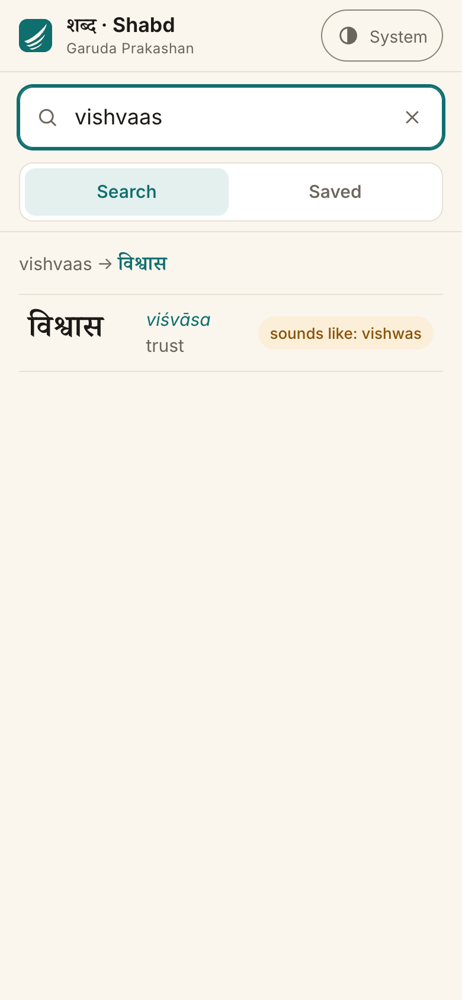
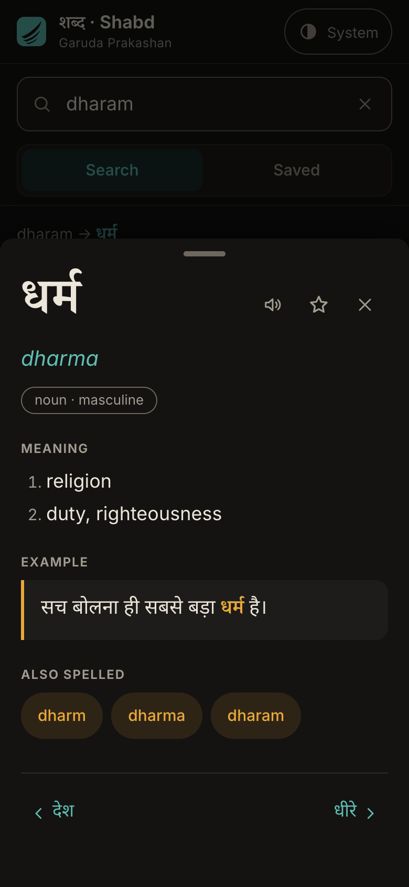
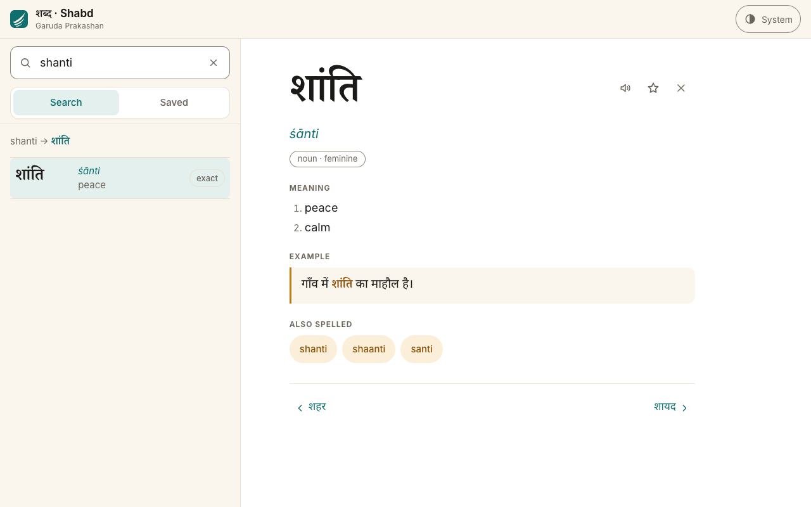

# Garuda Shabd · शब्द

A Hindi–English dictionary for Garuda Prakashan's readers, built as an installable, offline-first web app. Type a word the way you would on your phone (`dharam`, `vishvaas`, `shaanti`), in Devanagari, or in English, and each result says *why* it matched.

**Live:** _TODO: add the Vercel URL after the first deploy_ · **Code:** https://github.com/noor0021/garuda

| Phone · light | Phone · dark | Desktop · light |
|---|---|---|
|  |  |  |

More: [intro](docs/screenshots/phone-light-landing.png) · [settings](docs/screenshots/desktop-light-settings.png) · [home](docs/screenshots/phone-light-home.png) · [desktop dark](docs/screenshots/desktop-dark-home.png) · [Wiktionary fallback](docs/screenshots/phone-light-wiktionary.png)

## Why this exists

Garuda's readers meet words such as धर्म, श्रद्धा and संस्कृति in its books, and most of them type Hindi in Latin letters, each in their own way: *dharam*, *dharm*, *dharma*. A dictionary that only matches one spelling fails them on the first try. Garuda Shabd treats spelling variation as the normal case, not an error.

## Features

- **Spelling-tolerant search** in Devanagari, romanised Hindi or English, on every keystroke, with a "why matched" chip on every row (`exact`, `sounds like: vishwas`, `English: peace`, `starts with`, `close to: prakash`).
- **Live preview:** `dharam → धर्म` appears above the results, but only when the match is certain; the app never shows a guessed transliteration.
- **Entries** with the Devanagari headword as the hero, IAST, part of speech with gender (noun · feminine), numbered meanings, an example sentence with the word highlighted, "Also spelled" chips, Listen (device Hindi voice, hidden if there is none), Save, and previous/next in वर्णमाला order.
- **Browse** by वर्णमाला letter (क्ष, त्र and ज्ञ are letters of their own; letters with no words are greyed out), **Saved** words, recent searches, and a word of the day.
- **Works offline** after the first visit, installs to the home screen, and shows "New version available · Refresh" when Garuda publishes new words.
- **Not in the dictionary yet?** For a Devanagari word with no match, a clearly labelled, separate section shows up to three Hindi senses from Wiktionary (CC BY-SA) with a link to the source.
- **A guided tour** on a first visit to the home page (and behind the `?` button in the header): a spotlight walks through a real search for `dharam`, the Devanagari preview, the "why matched" chip, an entry's Listen and Save, the Saved tab and Settings. Tap anywhere, use the arrow keys, or Skip/Esc; it never starts on a shared word link.
- **An opening intro** (GSAP): the mark builds itself, शब्द appears, and three real searches play (`dharam → धर्म`, `vishvaas → विश्वास`, `peace → शांति`) before it hands over to the home page after 3 seconds. It plays once per visit, only on the home page (never on a shared word link), can be skipped, and can be switched off or replayed in Settings.
- **Settings** in one place (the gear in the header): theme (System, Light, Dark), text size (Default, Large: headwords, meanings and examples 15% larger, for older readers), animations (System, On, Off), the intro, Listen speed, clearing recent searches or saved words, and an About section with the dictionary version and offline status. Theme, text size and motion are applied before first paint, so nothing jumps on load.
- Phone bottom sheet with swipe-to-close, two panes on desktop, full keyboard use (`/` to search, `Enter` opens the top result, `Esc` clears or closes), and motion that switches off under the system's reduced-motion setting or the in-app one.

## Design

Most AI-built submissions land on the same look (warm paper, a serif, teal, pill chips, soft shadows). This one was redesigned around the structure of the script it serves.

- **Letterpress palette.** Vermilion (सिंदूर) on white; chalk on slate in dark mode. Two colours and ink, no shadows, no pill backgrounds, square corners. Chips are small caps with a thin vermilion underline; part of speech is small caps and senses are numbered, as in a printed dictionary. Every text pair is checked for WCAG AA by `npm run contrast`.
- **The shirorekha (शिरोरेखा).** Devanagari letters hang from a headline. The layout does the same: a solid 3px ink rule runs across the top of the search bar, the result list, the entry and the popovers, and the content hangs from it.
- **The mark.** A shirorekha bar in ink with one vermilion stroke hanging from it that sweeps into a wing-tip, for Garuda. It is two hand-written SVG paths (`public/logo.svg`), with no text or font in it, and it is the app's own mark, not Garuda Prakashan's logo.
- **The tour** is a TypeScript port of the spotlight tour from my own MediCord project (`TutorialOverlay.jsx`), restyled to these tokens: an SVG-mask spotlight, a caption card that travels with it and flips above or below by its measured height, and steps that set up the screen they point at.
- **Not shipped tonight:** the akshara breakdown (see "What I'd build next").

## Run it

Needs Node 22 or newer.

```bash
npm install
npm run dev        # http://localhost:5173
npm run check      # typecheck + lint + tests + dataset validator + contrast check
npm run build      # production build in dist/ (includes the prerender step)
npm run preview    # serve dist/
```

| Script | What it does |
|---|---|
| `dev` / `build` / `preview` | Vite dev server, production build (then `scripts/prerender.tsx`), preview |
| `typecheck` | `tsc --noEmit`, strict mode |
| `lint` | oxlint (correctness, suspicious, React, jsx-a11y) |
| `test` | Vitest: search, sound key, वर्णमाला, routes, validator mutation tests, Wiktionary, deploy config |
| `validate` | Checks `public/data/entries.json` (see [CONTRIBUTING.md](CONTRIBUTING.md)) |
| `contrast` | Prints the WCAG contrast of every colour pair in both themes; fails below AA |
| `bench` | Times search over the full dataset |
| `iast` | `npm run iast -- शब्द` prints the IAST an editor should use |

## How search works

Everything runs in the browser from one 30 kB JSON file (6.9 kB gzipped); there is no server.

**1. Script detection.** Any character in U+0900–U+097F makes it a Devanagari query; otherwise it is Latin.

**2. Normalising.** Devanagari: NFC; ZWJ/ZWNJ removed; nukta dropped (ज़ = ज) except on ड़/ढ़, which are different sounds; chandrabindu = anusvara; danda trimmed. Latin queries, every listed spelling and the de-accented IAST all go through the same **sound key** (`src/lib/sound-key.ts`):

| Step | Rule | Example |
|---|---|---|
| 1 | lowercase, strip diacritics | `viśvāsa` → `visvasa` |
| 2 | `chh→ch`, `sh→s`, `x→ks`, `jn→gy`, `w→v`, `z→j`, `q→k`, `ph→f` | `vishwas` → `visvas`, `jnana` → `gyana` |
| 3 | `ri`/`ru` after a first consonant → `r` | `vruksh`, `vriksh` → `vrks…` |
| 4 | `aa→a`, `ee→i`, `oo→u`, doubled letters collapsed | `shraddha` → `sradha` |
| 5 | `m` before a consonant → `n` | `sambandh` → `sanbandh` |
| 6 | drop one final `a` if 3+ letters remain | `shabda` → `sabd` |

**3. Five tiers,** best first; each entry keeps its best tier:

| Tier | Matches when | Chip |
|---|---|---|
| 1 | the headword, a listed spelling or the IAST, exactly | `exact` |
| 2 | same sound key (Latin), or same loose Devanagari key (शान्ति = शांति, पढना = पढ़ना) | `sounds like: …` |
| 3 | a whole English word or meaning (`peace`, `to eat`) | `English: …` |
| 4 | the start of a headword, spelling, key or English word | `starts with` |
| 5 | fuzzy (Fuse.js, threshold 0.3, within 0.1 of the best), queries of 4+ characters | `close to: …` |

Fuzzy hits are dropped entirely when any tier 1–3 match exists, so a correct answer never sits next to noise. Ties go by tier, then score, then वर्णमाला order; at most 20 results.

**A real query, walked through: `vishvaas`.** It is not a listed spelling, so tier 1 misses. Its sound key: `sh→s` gives `visvaas`, `aa→a` gives `visvas`. विश्वास's listed spelling `vishwas` also keys to `visvas` (`sh→s`, `w→v`), and so does its IAST *viśvāsa*. So tier 2 matches, the chip reads **sounds like: vishwas**, and because the match is certain the preview shows `vishvaas → विश्वास`. By contrast, `prakesh` keys to `prakes`, which matches nothing exactly, so it reaches tier 5 as **close to: prakash** under a "Did you mean" divider.

## Data

`public/data/entries.json` keeps the format from Garuda's brief, wrapped with a version: `{ "version": "1.0.0", "entries": [...] }`.

```json
{"id":3,"headword":"शब्द","transliteration":"śabda","romanised":["shabd","shabda","sabd"],"pos":"noun (m.)","meanings":["word","sound"],"example":"इस शब्द का अर्थ क्या है?"}
```

129 entries: Garuda's 10 starter words verbatim, plus 119 everyday and Garuda-relevant words (83 nouns, 21 verbs, 18 adjectives, 7 adverbs), including deliberate search stress-tests (ज्ञान, क्षमा, ऋषि, षड्यंत्र, पढ़ना, ज़िंदगी, गाँव…). One entry per line, so an editor's change is a one-line diff. **To add a word, see [CONTRIBUTING.md](CONTRIBUTING.md).** The app shape-checks the file at load and shows a "dictionary could not load" screen rather than crashing on a broken file.

## Quality gates

- **434 tests** (Vitest), including every search case from the plan, one chip per tier, all 322 listed spellings finding their own word first, and mutation tests that plant 14 kinds of data mistake and check the validator names each one.
- **Dataset validator** on every check and CI run: shape, unique ids/headwords/spellings, IAST matches the transliteration helper, spellings are lowercase a–z and not common English words, a spelling may not equal another word's IAST, examples contain the headword, part of speech (with gender for nouns) from a fixed list, and each spelling's search returns its own entry first.
- **Contrast check** of every colour pair in both themes against WCAG AA.
- **Deploy-config test:** the CSP must contain the exact hash of the inline theme script, and the headers and rewrites from the plan.
- **CI** (GitHub Actions, Node 22): `npm ci`, `npm run check`, `npm run build` on every push.
- **Browser checks** (Playwright driving Chrome, run locally): 24 interaction checks (keyboard, Back, swipe, storage blocked, theme without flash…), 16 intro and settings checks (plays once per visit, never on deep links, Skip, reduced motion, every setting applied at once and surviving a reload, replay), offline after a first visit, and frame-by-frame motion sampling. Zero console errors or warnings.

## Measured numbers

All measured on the development Mac.

| What | Result |
|---|---|
| Search, average over 20,000 searches (1,000 × 20 mixed queries, Node 25.2.1) | **34.8 µs** (0.035 ms); slowest are fuzzy queries, ~140 µs |
| Index build at load | 3.9 ms |
| `index.html` (prerendered shell and intro + inlined CSS) | 8.2 kB gzip |
| App JavaScript | 92.3 kB gzip (GSAP 27.1 kB more, lazy) |
| Dictionary `entries.json` | 6.9 kB gzip |
| Offline precache | 27 files, 815 KiB (includes the 6 font files, 382 kB) |

Lighthouse 12.6.1, mobile (simulated slow 4G, 4× CPU slowdown), production build served locally with the `vercel.json` headers:

| Page | Performance | Accessibility | Best Practices | SEO |
|---|---|---|---|---|
| `/` (with the intro playing) | 95–96 | 100 | 100 | 100 |
| `/w/dharm` | 96 | 100 | 100 | 100 |
| `/search?q=dharam` | 96 | 100 | 100 | 100 |

The first build scored 79 on Performance; [AI_LOG.md](AI_LOG.md) records each change that got it to 95–96. With the intro, five of six home runs scored 95–96; one scored 83 because that run's first paint took 947 ms on the machine (about 125 ms in the others). The intro's शब्द is prerendered and never animated, so it stays the fast largest paint. These are local runs; the deployed site should be re-measured once it is live.

## Trade-offs

- **Sanscript for IAST, hand-written rules for search.** IAST must be correct, so it comes from a tested library (Sanscript) plus three Hindi fixes it lacks: nukta letters, chandrabindu, and the anusvara rule used in Garuda's own starter data (शांति → śānti). Search keys must be *forgiving*, not correct, so they are a short, readable rule list that matches how people type. Sanscript is used only by the validator and editor tools, never shipped to the browser.
- **No router library.** The app has five routes; a 94-line History API router keeps the bundle small, and it stores the list behind an open word in `history.state`, so Back, close and reload all agree.
- **Local-first data.** The whole dictionary is one file in the browser: instant search, offline by default, no backend to run or secure. That is right at hundreds or a few thousand words; at Garuda's full dictionary size it would move to a split index or a lookup API (below).
- **PWA, not native.** One codebase installs on Android, iOS and desktop, updates without a store review, and is a link anyone can share. The price is no store listing, which an Android TWA would fix.
- **No accounts.** Saved words and recents stay on the device (and the app works with storage blocked). Nothing about a reader leaves their phone; the only network call besides the app itself is the labelled Wiktionary lookup.
- **Prerendered shell + hydration.** The header, search box, the top of Home and the opening intro are rendered into `index.html` at build time, and the bundle loads one frame after first paint. This took mobile Performance from 79 to 95–96.
- **An intro that costs nothing to skip.** A splash screen on every visit would slow down a reference tool people open many times a day, so it plays once per visit, never on shared links, never blocks a reader who wants to search (Skip, Esc, "Start searching"), and has a CSS fallback that removes it even if JavaScript fails.

## What I'd build next

1. **An editor workflow fed by missed searches.** Count zero-result queries on the device (no personal data) and, with consent, send them in batches. Garuda's editors then get a queue of the words readers actually looked for, ranked by demand, each ready for a validated pull request.
2. **A lookup API** (`/api/w/:slug`, `/api/search?q=`) so garudabooks.com product pages and the Garuda apps can show a word's meaning inline.
3. **A browser extension:** select a Hindi word on any page, including Garuda's e-books on the web, and see the entry in a popover.
4. **Recorded pronunciations** by Garuda's own narrators, replacing device text-to-speech, which varies in quality and is missing on many phones.
5. **Etymology and Sanskrit roots** (धर्म ← √धृ "to hold"), which suit Garuda's readership and its books.
6. **An Android TWA** to list the same app on the Play Store.
7. **Inflected forms:** plurals and oblique forms (किताबें, *kitaabein*) and verb forms (पढ़ता, पढ़ी) mapped to their headword.
8. **The akshara breakdown** (planned for this pass, cut at its 11:10 PM cut-off): under the IAST, the headword split into grapheme clusters with `Intl.Segmenter`, each with its IAST beneath (ध / dha · र्म / rma), tappable to hear. It needs care: a naive per-cluster transliteration misreads conjuncts and anusvara, so it was left out rather than shipped unchecked. The tour already has a step for it, which skips itself until it exists.
9. **A Roman→Devanagari morph** on the preview line (the typed letters scramble into the headword), also cut for time.
10. **Growing the dataset** with Garuda's editors (लड़का is the first gap the tests found), plus a Hindi-language interface option.

## Project files

```
public/data/entries.json   the dictionary
src/lib/                   pure logic: search, sound key, normalisation, वर्णमाला, routes, Wiktionary
src/components, src/screens  UI
src/styles/                tokens (both themes) and styles
scripts/                   validator, IAST helper, benchmark, contrast check, prerender
tests/                     Vitest suites
docs/screenshots/          README images
PLAN.md · AI_LOG.md        the spec this was built to, and how AI was used
```
